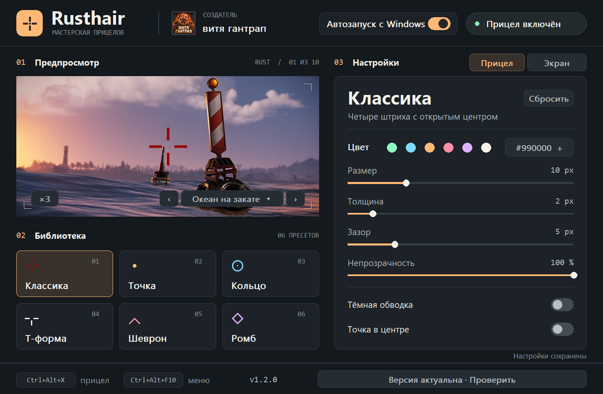
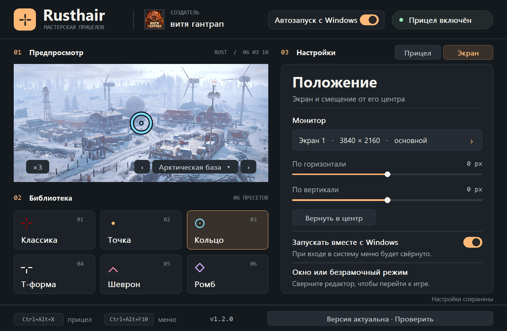

# Rusthair

**English** · [Русский](README.ru.md)

A crosshair workshop for Windows. Tune a sight against a dark forest, a bright snowfield or the ocean at sunset, then put it at the center of your monitor. The editor, all ten Rust scenes and the overlay fit in one portable Go executable.

**Windows 10/11 x64** · Portable EXE · Russian-language editor

[Download Rusthair.exe](https://github.com/Grizz1ya/Rusthair/releases/latest/download/Rusthair.exe) · [Release notes and SHA-256](https://github.com/Grizz1ya/Rusthair/releases/latest)

Double-click the downloaded file to open the workshop. It runs as a regular user.



## Design your sight

Choose a cross, dot, ring, T, chevron or diamond. Each preset remembers its own color, size and opacity. Adjust stroke width and gap where the shape supports them, add a center dot, or turn on a dark outline for contrast against snow and sky.

The arrows below the preview cycle through ten in-game screenshots. Click the scene name to jump straight to one. **×1** shows the sight at its actual pixel size. **×3** lets you inspect its edges.

## Put it on screen

1. Open **Экран** (Display), select a monitor and adjust the horizontal or vertical offset in physical pixels.
2. Use the top-right switch to turn the sight on, then minimize the editor. Use a windowed or borderless game.
3. Toggle the sight with **Ctrl+Alt+X** and bring the editor back with **Ctrl+Alt+M**. If another app owns a shortcut, the footer shows the combination Rusthair registered.

Closing the editor with **×** hides it in the system tray while the sight stays active. Click the Rusthair tray icon to reopen the editor. Right-click it to toggle the sight, check releases or choose **Выход** (Exit) to stop the app completely.

The footer shows your installed version. Rusthair checks the latest stable GitHub release at launch and every six hours. You can also check manually. When a newer release is available, an amber button opens its GitHub page. Windows may also show a tray notification. Download the new EXE from that page, exit Rusthair from its tray menu and replace the old file. Settings remain in your user profile.



**Автозапуск с Windows** starts the editor minimized when you sign in and restores your saved sight. The same switch is available in the header and the Display tab. Settings are stored in `%APPDATA%\Rusthair\settings.json`.

## How it works

Rusthair draws a click-through, topmost Win32 window using `UpdateLayeredWindow`. The game keeps mouse and keyboard input. The overlay runs without game-process memory access, DLL injection or a driver. Exclusive fullscreen can hide it. Check the rules of the game or server where you plan to use it. The release executable is unsigned.

## Build from source

On Windows, install Go 1.23 or later and run the following in PowerShell from the repository root.

```powershell
.\build.ps1
```

The result is `Rusthair.exe`. The app uses the Go standard library and Windows system DLLs. The checked-in `.syso` contains the icon, DPI manifest and version information. If you change `winres/`, regenerate the resource before building.

```powershell
go run github.com/tc-hib/go-winres@v0.3.3 make --arch amd64
```

## Credits

Created by **витя гантрап**. Clicking the name or avatar in the editor opens the creator’s Steam profile. [Steam profile](https://steamcommunity.com/id/misha_litvin/)

The Rust preview scenes are screenshots published by Facepunch. [World Update 2.0](https://rust.facepunch.com/news/world_update_2) · [Lighting the Way](https://rust.facepunch.com/news/lighting-the-way) · [Arctic Update](https://rust.facepunch.com/news/arctic-update) · [Jungle Update](https://rust.facepunch.com/news/jungle-update)
