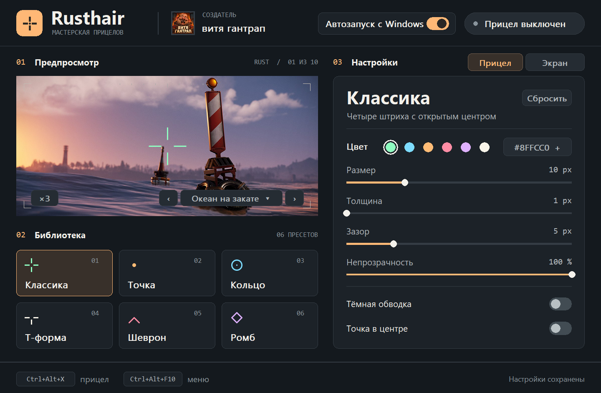
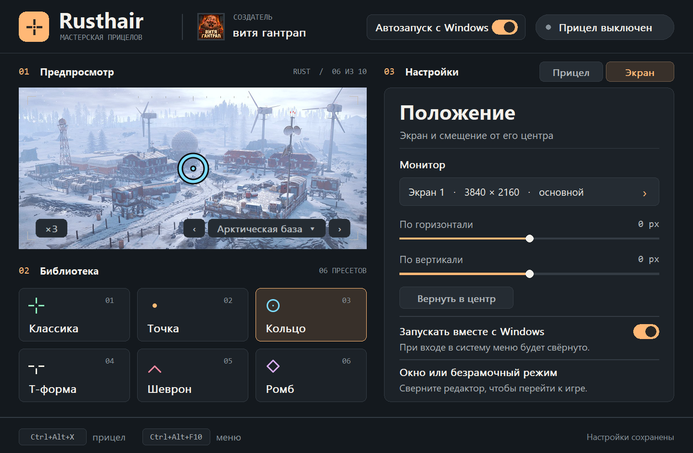

# Rusthair

[English](README.md) · **Русский**

Мастерская прицелов для Windows. Подбери прицел, который видно и в ночном лесу, и на снегу, проверь его на скриншотах Rust и выведи в центр своего монитора. Редактор, оверлей и десять игровых сцен помещаются в один EXE на Go.

**Windows 10/11 x64** · Портативный EXE · Интерфейс на русском

[Скачать Rusthair.exe](https://github.com/Grizz1ya/Rusthair/releases/latest/download/Rusthair.exe) · [Описание релиза и SHA-256](https://github.com/Grizz1ya/Rusthair/releases/latest)

Запусти скачанный файл двойным щелчком. Установка и права администратора не нужны.



## Настрой прицел

Выбери классику, точку, кольцо, Т-форму, шеврон или ромб. Каждая форма запоминает свой цвет, размер и непрозрачность. В зависимости от формы можно настроить толщину штрихов и зазор, включить точку в центре. Тёмная обводка помогает сохранить контраст на фоне снега и неба.

Стрелки под предпросмотром переключают десять игровых сцен. Нажми на название, чтобы выбрать, например, Радтаун, зиккурат или арктическую базу. В масштабе **×1** прицел показан в реальных пикселях. **×3** удобен для тонкой настройки.

## Выведи на монитор

1. На вкладке **«Экран»** выбери монитор. При необходимости смести прицел по горизонтали или вертикали на нужное число пикселей.
2. Включи прицел кнопкой справа в шапке и сверни редактор. Запусти игру в оконном или безрамочном режиме.
3. **Ctrl+Alt+X** включает и выключает прицел. **Ctrl+Alt+M** возвращает меню. Если сочетание занято, Rusthair покажет действующую комбинацию внизу окна.



Переключатель **«Автозапуск с Windows»** запускает редактор свёрнутым при входе в систему и восстанавливает сохранённый прицел. Переключатель есть в шапке и на вкладке «Экран». Настройки хранятся в `%APPDATA%\Rusthair\settings.json`.

## Как это работает

Rusthair рисует отдельное окно поверх рабочего стола через Win32 `UpdateLayeredWindow`. Оно пропускает клики и оставляет ввод игре. Программа работает без чтения памяти игр, внедрения DLL и драйверов. В эксклюзивном полноэкранном режиме игра может скрыть оверлей. Допустимость внешнего прицела зависит от правил игры и сервера. У релизного EXE нет цифровой подписи издателя.

## Сборка из исходников

Установи Go 1.23 или новее в Windows и выполни в PowerShell из корня репозитория.

```powershell
.\build.ps1
```

В корне появится `Rusthair.exe`. Программа использует стандартную библиотеку Go и системные DLL Windows. Иконка, манифест DPI и сведения о версии уже включены в файл `.syso`. Если меняешь `winres/`, перед сборкой обнови этот ресурс.

```powershell
go run github.com/tc-hib/go-winres@v0.3.3 make --arch amd64
```

## Автор и изображения

Создатель — **витя гантрап**. Нажатие на имя или аватарку в редакторе открывает профиль автора. [Профиль в Steam](https://steamcommunity.com/id/misha_litvin/)

Игровые сцены взяты из официальных публикаций Facepunch о Rust. [World Update 2.0](https://rust.facepunch.com/news/world_update_2) · [Lighting the Way](https://rust.facepunch.com/news/lighting-the-way) · [Arctic Update](https://rust.facepunch.com/news/arctic-update) · [Jungle Update](https://rust.facepunch.com/news/jungle-update)
